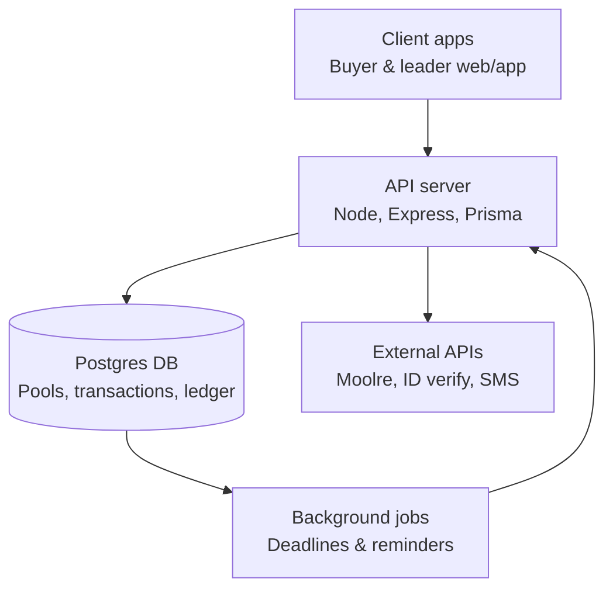
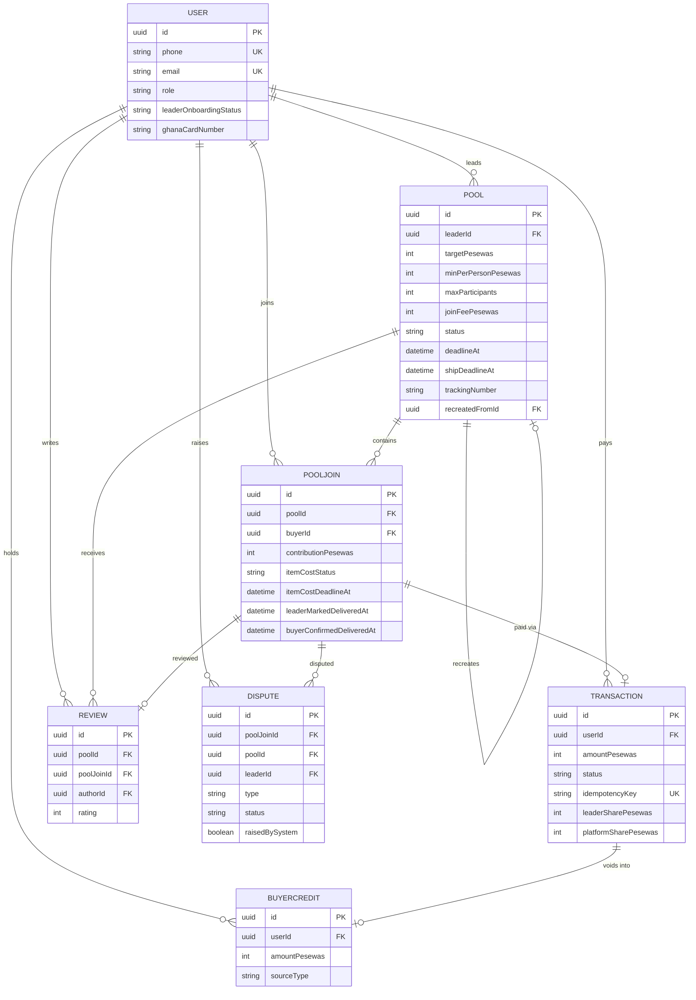
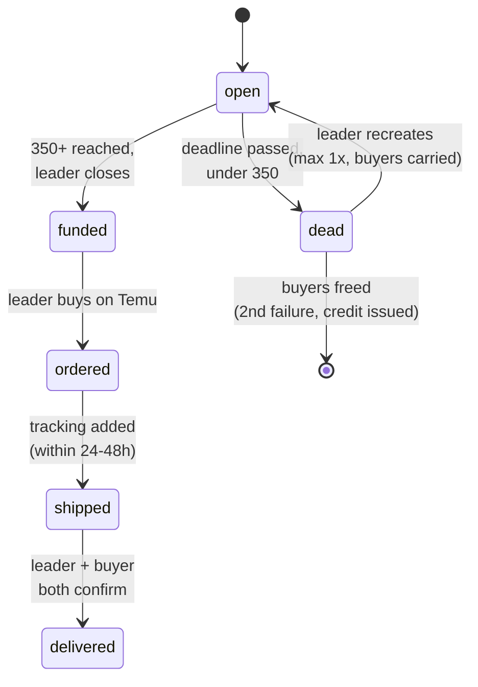
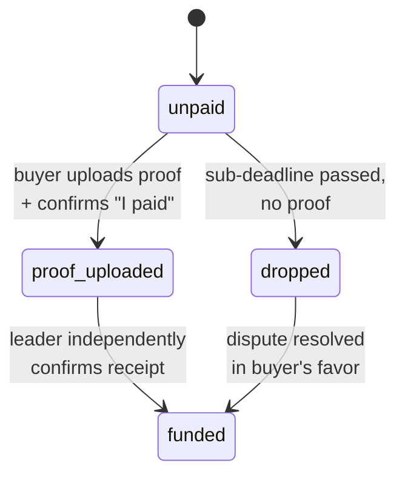
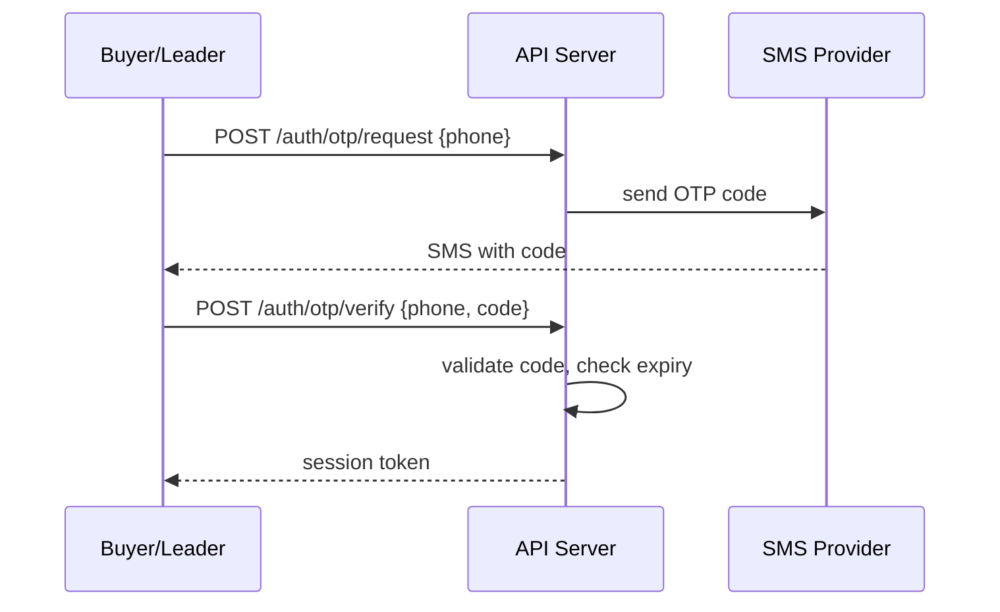
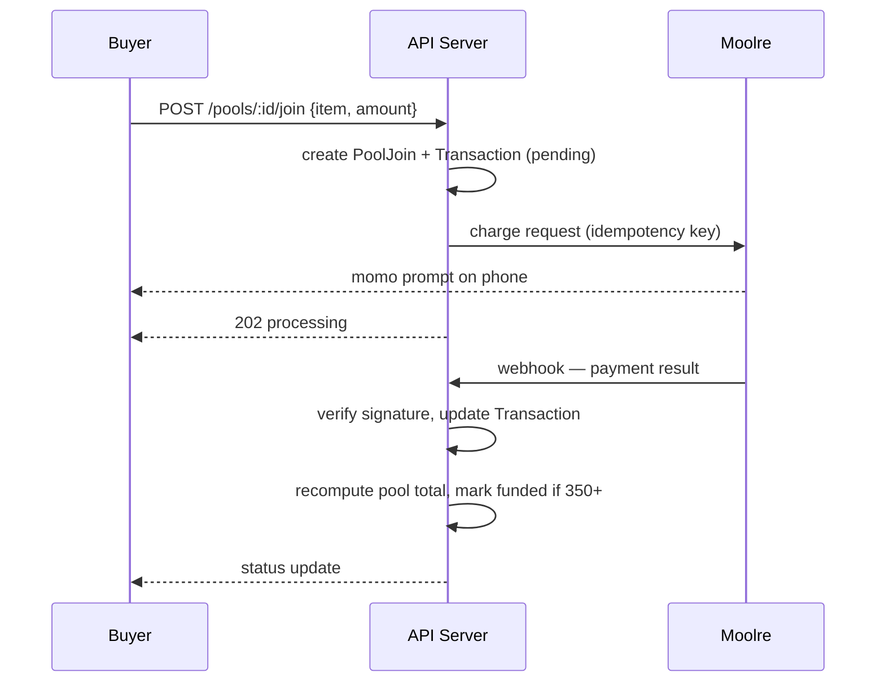
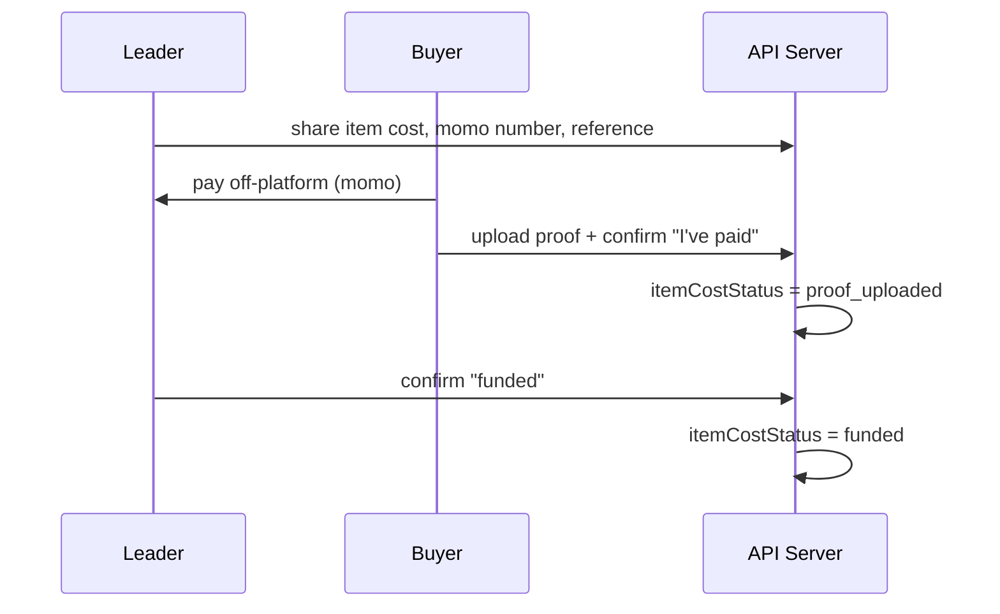
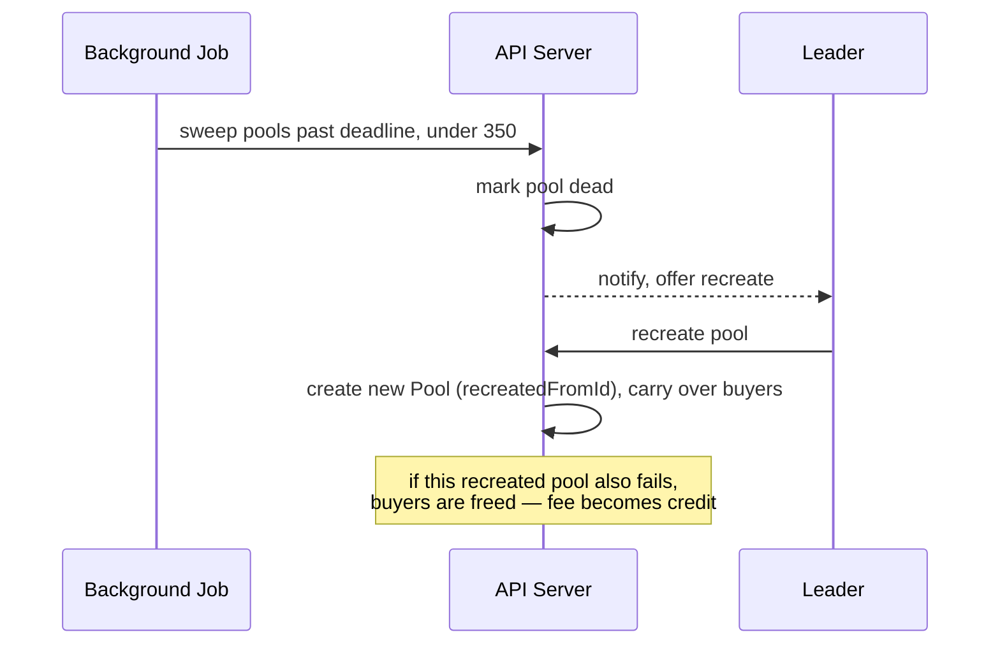
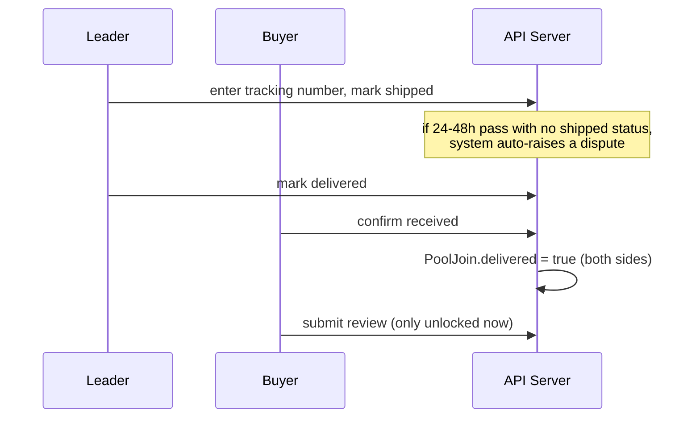

# Temu Group-Order Platform — System Design

## 1. Overview

A marketplace platform for pooling Temu orders in Ghana to meet the 350 cedi cart minimum. Buyers join pools run by onboarded "pool leaders" (or the platform itself), paying a join fee through the platform and an item cost directly to the leader off-platform. The platform's job is trust infrastructure: payment tracking, identity verification, dispute handling, and reputation — not the actual purchase or delivery.

**Stack:** Node.js / Express, PostgreSQL, Prisma ORM, Moolre (mobile money payments), SMS provider (OTP), Ghana Card verification provider.

---

## 2. High-Level Architecture

- **API server** handles everything a user directly triggers: joining pools, uploading proof, managing pools, auth.
- **Background jobs** run on a schedule (separate process) and enforce every deadline: pool join window, item-cost sub-deadline, shipping deadline. Nothing in this system self-enforces without a job sweeping for it.
- **External APIs**: Moolre for payments, a Ghana Card verification provider for leader onboarding, an SMS provider for OTP and reminders (Moolre likely doesn't cover SMS — confirm during integration).

---

## 3. Data Model (ERD)

Full field-level definitions live in `schema.prisma` (companion file). Key modeling choices:

- `User` covers both buyers and leaders — one identity (phone-OTP verified), a `role` flag, leader-only fields unused for plain buyers.
- Money is stored as **integer pesewas** throughout, never decimal cedis.
- `ItemCostStatus` and delivery both use **two independent confirmation fields** (not one shared boolean) to structurally enforce two-sided confirmation.
- `Dispute` supports system-raised entries (`raisedBySystem`) for the automatic shipping-deadline escalation, not just buyer-raised disputes.

---

## 4. State Machines

### 4.1 Pool status

- **Hard floor:** a pool can never close below 350 cedis, regardless of its self-set target.
- **Leader discretion:** above 350, the leader can close any time — target is a planning goal, not an enforced gate.
- **Missed shipping deadline** (24-48h after `funded`→`ordered`) doesn't change pool status directly — it auto-raises a system `Dispute` and flags the leader's profile.

### 4.2 Item cost status (per `PoolJoin`)

- Neither side's action alone flips to `funded` — this is the two-sided confirmation rule.
- A buyer who paid but missed the upload deadline recovers through the same dispute mechanism, not a separate exception path.

---

## 5. Key Flows (Sequence Diagrams)

### 5.1 OTP authentication

Rate-limit both endpoints: cooldown on resend, max attempts on verify.

### 5.2 Join a pool + join fee payment

Webhook handler must be idempotent (check current `Transaction.status` before applying) and signature-verified. Background jobs poll Moolre for any transaction stuck `pending` too long, as a fallback if the webhook is lost.

### 5.3 Item cost — two-sided confirmation

### 5.4 Pool failure and recreation

### 5.5 Delivery confirmation and review

---

## 6. API Endpoints

### Public (no auth)
| Method | Path | Description |
|---|---|---|
| GET | `/pools` | Browse/filter open pools (platform + leader) |
| GET | `/pools/:id` | Pool detail |
| GET | `/leaders/:id` | Leader profile — rating, reviews, active/past pools |

### Auth
| Method | Path | Description |
|---|---|---|
| POST | `/auth/otp/request` | Send OTP to phone |
| POST | `/auth/otp/verify` | Verify code, issue session |
| POST | `/auth/recovery/email` | Request recovery via email if phone is lost |

### Buyer (session required)
| Method | Path | Description |
|---|---|---|
| POST | `/pools/:id/join` | Join a pool, initiate join-fee payment |
| PATCH | `/pool-joins/:id` | Edit item/quantity (only if `editableUntilPaid`) |
| DELETE | `/pool-joins/:id` | Voluntarily leave (fee forfeited) |
| POST | `/pool-joins/:id/proof` | Upload item-cost proof, confirm "I've paid" |
| POST | `/pool-joins/:id/confirm-delivery` | Buyer confirms receipt |
| POST | `/pool-joins/:id/disputes` | Raise a dispute |
| POST | `/reviews` | Submit a review (requires delivered status) |
| GET | `/me/orders` | All of the buyer's pool joins with status |
| GET | `/me/credit` | Platform credit balance |

### Leader (session + approved leader)
| Method | Path | Description |
|---|---|---|
| POST | `/leader-applications` | Apply — Ghana Card, selfie, pay onboarding fee |
| POST | `/pools` | Create a pool |
| PATCH | `/pools/:id/close` | Manually close (leader discretion, above 350) |
| POST | `/pools/:id/recreate` | Recreate a dead pool (max once) |
| POST | `/pools/:id/tracking` | Enter tracking number, mark shipped |
| POST | `/pool-joins/:id/confirm-funded` | Leader confirms item-cost receipt |
| POST | `/pool-joins/:id/mark-delivered` | Leader marks delivered |
| GET | `/leader/dashboard` | Active pools, pending confirmations, earnings |
| GET | `/leader/payouts` | Payout/earnings history |

### Webhooks
| Method | Path | Description |
|---|---|---|
| POST | `/webhooks/moolre` | Payment confirmation — signature-verified, idempotent |
| POST | `/webhooks/ghana-card` | ID verification callback (if provider is async) |

### Admin (Phase 2, internal)
| Method | Path | Description |
|---|---|---|
| GET | `/admin/leader-applications` | Review pending applications |
| POST | `/admin/leaders/:id/suspend` | Suspend a leader |
| GET | `/admin/disputes` | Review flagged disputes |

---

## 7. Background Jobs

Run on a schedule, separate process from the API server:

| Job | Trigger | Action |
|---|---|---|
| Pool deadline sweep | `Pool.deadlineAt` passed, total < 350 | Mark `dead`, notify leader with recreate option |
| Item-cost sub-deadline sweep | `PoolJoin.itemCostDeadlineAt` passed, still `unpaid` | Drop buyer, convert fee to credit |
| Item-cost reminder | Approaching `itemCostDeadlineAt` | Send reminder notification |
| Shipping deadline sweep | `Pool.shipDeadlineAt` passed, not `shipped` | Auto-raise system dispute, flag leader profile |
| Moolre reconciliation poll | `Transaction` stuck `pending` beyond a threshold | Poll Moolre status API directly, resolve |

---

## 8. Security & Reliability Notes

- **Idempotency**: every Moolre charge request carries an idempotency key; the webhook handler checks current transaction status before applying any update.
- **Webhook signature verification**: never trust an incoming webhook without validating Moolre's signature header.
- **Money in integer pesewas** throughout — no floating-point decimal cedis anywhere in the codebase.
- **State-machine enforcement lives in a service layer**, not scattered across route handlers — e.g. a `poolService.markFunded()` function checks both confirmations and pool status before writing, so the rule exists in one place.
- **Rate limiting** on OTP request/verify to prevent SMS-bombing and brute force.
- **Authorization checks** on every leader-only endpoint — a leader must only be able to act on pools they own.

---

## 9. Phase 2 (explicitly deferred)

- Real SpeedAF tracking integration via a multi-carrier aggregator (AfterShip, 17TRACK, or Track123)
- In-platform group chat auto-created when a pool funds (WhatsApp group link as an interim workaround)
- Full admin panel UI (manual review via database/notifications is sufficient at MVP scale)
